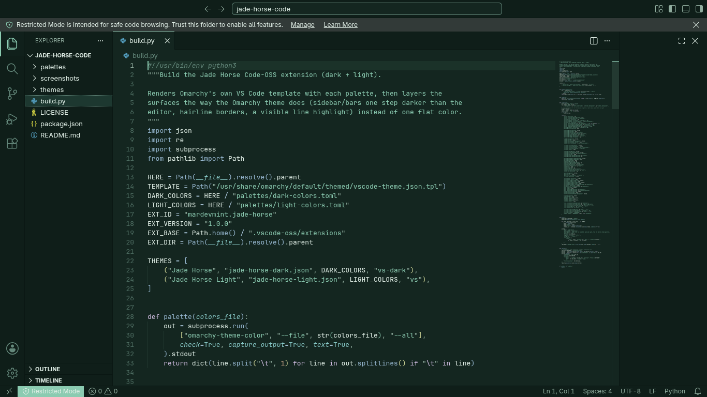
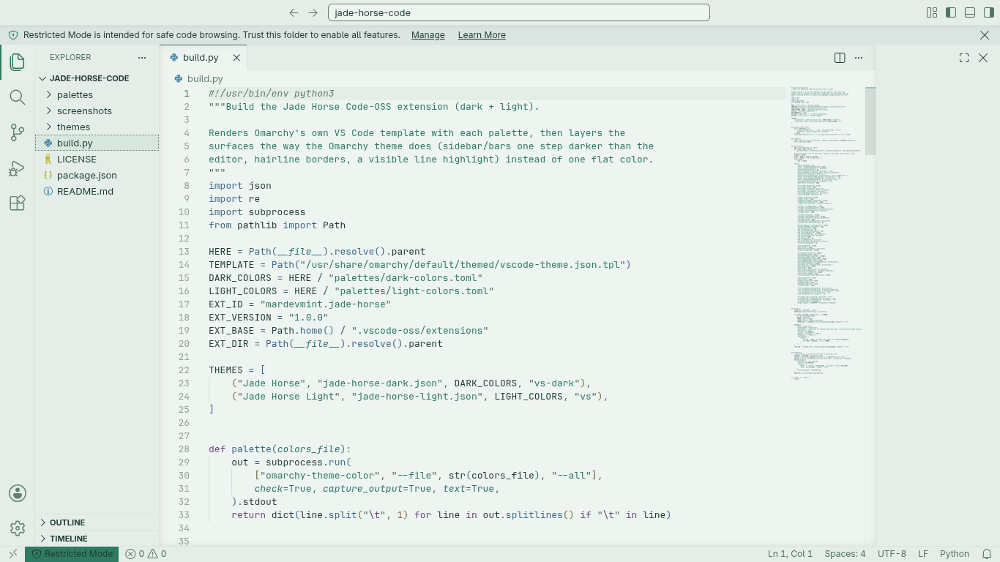

# Jade Horse for VS Code

A quiet jade color theme for VS Code and Code-OSS, in dark and light, built from
DHH's [Jade Horse theme for Omarchy](https://github.com/dhh/omarchy-jade-horse-theme).

Deep pine and celadon at night, pale celadon rice paper with pine ink by day.
Cool green, never olive. Soft contrast for long coding sessions.

| Jade Horse | Jade Horse Light |
| --- | --- |
|  |  |

## Install

```sh
git clone https://github.com/MarDevMint/jade-horse-code ~/.vscode-oss/extensions/mardevmint.jade-horse-1.0.0
```

Use `~/.vscode/extensions/` for Microsoft VS Code. Restart, then pick the theme
with `Ctrl+K Ctrl+T`.

## Follow the system

Let the editor switch with your desktop's light/dark preference:

```jsonc
"window.autoDetectColorScheme": true,
"workbench.preferredDarkColorTheme": "Jade Horse",
"workbench.preferredLightColorTheme": "Jade Horse Light"
```

## Build

`build.py` regenerates `themes/` from `palettes/` using Omarchy's VS Code
template, so it needs an Omarchy system.

## License

MIT
